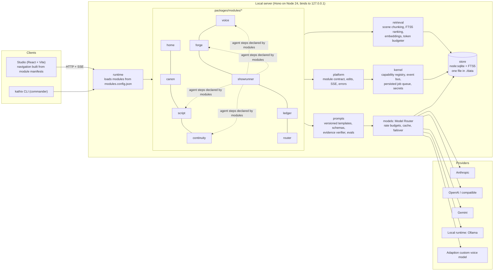

# Kathix

**A production co-pilot stack for solo creators of serialized work.** Kathix keeps your world, your voice and your output consistent across every episode, and you stay the author of every line.

Built for **GeNarrative Clash 2026**, Track 03 (Autonomous Creator Agents), with strong overlap into Track 01 (Storytelling and Co-Writers). This repository is the Round 1 submission: about half of the product, fully working. The rest is listed under [Roadmap for the finale](#roadmap-for-the-finale).

---

## Problem statement

A creator's body of work outgrows their memory. By episode ten of a video series, podcast, web serial or comic, they contradict episode three. They drift from the voice their audience followed them for, and they lose hours re-reading their own material to check what is true.

Generic chat assistants make this worse. They forget the canon between sessions, write in a flat house style, and present guesses as facts. A creator who leans on them ends up with work that sounds like everyone else's and still has continuity errors.

## Solution

Kathix is a local-first studio with eight modules that share one memory of your work:

- A **Canon Vault** holds your story bible. Every entry carries the exact passage it came from.
- A **co-writer** proposes and never imposes. Each suggestion is a diff with a reason and the canon it relied on, and nothing enters a script until you accept it.
- **Continuity Guard** catches contradictions with your canon and earlier episodes. Every issue quotes both passages word for word.
- **Voice Mirror** measures your voice in code and flags lines that drift from it.
- **Hook and Title Forge** packages an episode honestly and flags any promise the script doesn't deliver.
- A **Showrunner** agent runs the whole pipeline and stops for your decision after every step.
- A **Provenance Ledger** shows how much of each script is yours, character by character.
- A **Model Router** connects providers with failover, a response cache, rate budgets and a usage meter.

## What is built (Round 1)

| Module                                 | What you can do                                                                                                                                                                                                                                                                                                                                                                                                                                                                                                                                                                                |
| -------------------------------------- | ---------------------------------------------------------------------------------------------------------------------------------------------------------------------------------------------------------------------------------------------------------------------------------------------------------------------------------------------------------------------------------------------------------------------------------------------------------------------------------------------------------------------------------------------------------------------------------------------- |
| **Studio Home**                        | Create, rename, archive and open projects (video series, podcast, fiction, comic). Get one next best action computed from project state. Launch any available module, read the activity timeline, and use the global command palette and search (Ctrl/⌘+K).                                                                                                                                                                                                                                                                                                                                    |
| **Canon Vault**                        | Paste or upload `.txt`, `.md`, `.docx` or text-based `.pdf`. The AI proposes entries in 9 types, and each proposal shows its verbatim source passage. Approve, edit, merge, reject (with undo) or bulk-approve by type. Entry pages show relationships, every script mention and change history. Also: in-world timeline, relationship graph, open-promises tracker, and Markdown/JSON export.                                                                                                                                                                                                 |
| **Script Studio**                      | CodeMirror editor that styles scene headings, speaker labels and notes. Autosaves every change, and counts words, scenes and runtime. Co-writer actions: continue, rewrite, tighten, expand, change tone, three alternatives, punch up dialogue, and free-form instruction. Results stream into suggestion cards (diff, reason, clickable evidence) that you accept, edit then accept, or reject with a reason. A canon side panel follows the cursor. Coach mode asks questions and writes nothing. Version history with visual compare and restore. Export to Markdown, plain text and Word. |
| **Continuity Guard**                   | Checks a script against the vault and earlier episodes for six issue types. Shows both passages side by side, with severity, confidence and a proposed fix. You can apply the fix, edit the canon instead, or mark the issue intentional, which is remembered forever. Optional background check on save, plus a project health view. Standalone two-box mode.                                                                                                                                                                                                                                 |
| **Voice Mirror**                       | Sample intake with an ownership confirmation. A voice profile measured in code: sentence-length distribution, vocabulary richness, signature phrases, punctuation, point of view, reading level, pacing and function-word fingerprint, with a short AI description on top. Line-level drift report with suggested rewrites. Several profiles per project. JSONL training-dataset export. Uses your Adaption voice model when one is connected.                                                                                                                                                 |
| **Hook and Title Forge**               | Generates hooks, titles, thumbnail text and one-line descriptions for 5 platforms. Length limits are enforced in code and never exceeded. Every option is scored on clarity, curiosity, honesty and voice match, each with a reason. Clickbait is flagged with the missing payoff named. Shortlist, compare side by side, refine with a note, copy and export.                                                                                                                                                                                                                                 |
| **Showrunner**                         | You state a goal, and the agent plans only from modules that can run right now. It drafts from the outline, checks continuity and voice, proposes fixes, then writes hooks and titles. It stops for approval after every step: approve, edit, redo with a note, skip or stop. A live view shows the current step, what the agent is reading, tokens used and time elapsed. Runs survive restarts, and any run can be saved and replayed as a template.                                                                                                                                         |
| **Provenance Ledger and Model Router** | Every suggestion offered, accepted, edited or rejected is logged with module, model and time. Text is coloured by origin, with a human share computed from characters, and a Markdown disclosure statement can be exported. The router covers provider setup from live model lists (no model names are hardcoded), fast/balanced/deep tiers, rate budgets, a priority queue, a prompt-hash cache, automatic failover, a local fallback and a usage screen.                                                                                                                                     |

Every module also works as a standalone tool with no project open. Every module is also a command: `pnpm kathix --help`.

## Architecture



The full design is in [docs/ARCHITECTURE.md](docs/ARCHITECTURE.md). The key properties:

- **Module contract.** Each module declares an id, the capabilities it needs, its routes, its navigation entry, its palette actions, its CLI command and any Showrunner steps it offers. To add a module, add one package and one line to `modules.config.json`.
- **Capability gating.** At startup, and whenever settings change, real probes check `model.text`, `model.structured`, `model.embeddings`, `model.custom.adaption`, `model.local` and `store.ready`. A control is either fully working or absent: nothing is greyed out. With no model connected, only the setup screen is shown.
- **Nothing is overwritten.** Every script change creates a new version with character-level authorship spans. Jobs are persisted with checkpoints and resume after a restart.

## Tech stack

| Layer    | Choice                                                                                                                  |
| -------- | ----------------------------------------------------------------------------------------------------------------------- |
| Language | TypeScript (strict) in a pnpm workspace monorepo                                                                        |
| Server   | Node.js 24, Hono, server-sent events for streaming                                                                      |
| Database | Node's built-in `node:sqlite` with FTS5. No native build step on any OS                                                 |
| Client   | React 19, Vite 8, CodeMirror 6, Inter and Literata bundled locally                                                      |
| AI       | Model Router over Anthropic (official SDK), OpenAI and OpenAI-compatible, Gemini, Ollama and Adaption, with zod schemas |
| Tests    | Vitest (unit, integration, prompt evals) and Playwright (demo path, UI truth test, performance)                         |
| Quality  | ESLint (typescript-eslint), Prettier, GitHub Actions CI                                                                 |

## Setup

You need only **Node.js 24+** and **pnpm 10+**.

```bash
pnpm install
```

```bash
pnpm start
```

This builds and starts the Studio at **http://127.0.0.1:4319**. On first launch, connect a model: paste an Anthropic, OpenAI or Gemini key, or the address of any OpenAI-compatible endpoint or a local Ollama. Keys are stored encrypted in `./data` and never reach the browser. You can also put keys in `.env`; copy `.env.example`, which documents every variable.

```bash
pnpm seed
```

This loads the sample project, _The Lantern Keepers_, through the normal import paths, and works with no provider configured. You can also click **Open the sample project** in the Studio.

Other commands:

| Command              | What it does                                                                                                                           |
| -------------------- | -------------------------------------------------------------------------------------------------------------------------------------- |
| `pnpm dev`           | Studio with live reload                                                                                                                |
| `pnpm kathix --help` | Every module as a CLI command                                                                                                          |
| `pnpm test`          | Everything: unit, integration, evals, then Playwright end-to-end (uses Playwright's Chromium if installed, else system Edge or Chrome) |
| `pnpm test:unit`     | Unit, integration and prompt evals only                                                                                                |
| `pnpm evals:real`    | Prompt evals against your real provider; results go to `docs/EVALS.md`                                                                 |
| `pnpm check`         | Typecheck, lint, format check and all tests                                                                                            |
| `pnpm backgrounds`   | Rebuild the background image set                                                                                                       |

## How AI is used

- **Models.** All calls go through the Model Router with a versioned prompt template, a declared output schema and a test. No module calls a provider directly, and no model name is hardcoded. Each tier (fast for inline rewrites and titles; balanced for canon extraction, continuation, voice rewrites and hooks; deep for continuity analysis and Showrunner planning) defaults to a model picked from the provider's live model list by size hints. You can change it on the Model Router screen. Failover runs across tiers and providers, ending with a local Ollama runtime when one answers. If you switch a provider off mid-request, the call is retried on the next one with no action from you.
- **Retrieval.** Scripts are chunked by scene and canon by entry, then ranked with SQLite FTS5 (BM25, porter stemming). Embedding similarity is added when an embedding model is available, with boosts for recent episodes and for entries linked to characters present in the passage. A token budgeter assembles context per task and records exactly what was included, so the evidence list you see is the real context.
- **Grounding.** Evidence means verbatim spans. After every call, code checks that each quoted span exists in its source and maps it to real character offsets. The check tolerates only whitespace, case and typographic quotes. Anything unverified is dropped before you see it. A canon proposal without a verbatim source is discarded, and a continuity issue must quote both passages. Models can say "not enough information", and the UI shows that plainly. Canon is never written by a model: models propose, and you approve.
- **Prompt safety.** Every prompt follows a fixed order: role and task, rules, output schema, then your material inside `<data>` blocks. The rules state that data is never an instruction, and closing tags inside data are escaped. No imported text can trigger an action.
- **Structured output.** Native JSON-schema mode is used when the probe shows it works; otherwise the model gets strict JSON instructions and the same validator applies. If an answer fails validation, Kathix retries once with the error, then fails over to another model, then shows a plain-language error.
- **Custom voice model (Adaption).** Voice Mirror exports a JSONL file of `{"instruction", "response"}` pairs built only from your own samples. This works without any Adaption account. To train:
  1. Upload the file to Adaption, either in its app or through its datasets API, with column mapping `prompt = instruction` and `completion = response`.
  2. Start an AutoScientist run with `training_method: "instruction"`.
  3. Set `ADAPTION_API_KEY` in `.env`, then pick your trained model (or `stack:<slug>`) on the Model Router screen, or set `ADAPTION_VOICE_MODEL`.

  Kathix calls it through Adaption's Responses API (`POST /api/v1/responses`). Once the probe succeeds, Script Studio shows **Write with my Adaption voice model**. Without credentials, no Adaption control is rendered anywhere.

## Track and judging criteria

| Criterion                     | Weight | How Kathix meets it                                                                                                                                                                                                                                                                  |
| ----------------------------- | ------ | ------------------------------------------------------------------------------------------------------------------------------------------------------------------------------------------------------------------------------------------------------------------------------------ |
| Innovation and creative theme | 25%    | It targets a specific creator bottleneck: staying consistent in canon and voice across a growing body of work. Every AI action is a proposal with its reason and evidence, and the creator decides.                                                                                  |
| 50% functional prototype      | 25%    | Eight modules work end to end. A Playwright test runs the full demo path in about 30 seconds. The UI truth test clicks every visible control on every route and fails on any control with no effect.                                                                                 |
| AI integration and depth      | 25%    | Multi-step Showrunner agent with checkpoints, retrieval over your own canon, schema-validated structured output, verbatim evidence verification, a multi-provider router with failover, and an Adaption custom-model path.                                                           |
| Architecture and code quality | 15%    | Modular monorepo with typed contracts. Modules register through manifests and never import each other's internals. 82 unit, integration and eval tests, plus end-to-end tests, lint, format and CI.                                                                                  |
| UI/UX                         | 10%    | The "Studio After Dark" theme uses a warm accent for the creator and a cool accent for AI. Each screen has one primary action, there are no greyed-out controls, and destructive actions offer undo. The UI is keyboard operable, uses the creator's language, and has a focus mode. |

## Known limitations

- No real model provider key was available while this was built. Every test, eval and the recorded demo path run against the deterministic test provider. That provider exercises the real parsing, verification, storage and UI paths, but it does not measure model quality. Real-provider quality is checked with `pnpm evals:real`, which records results in `docs/EVALS.md`.
- The Adaption adapter follows Adaption's published Responses API. It was not exercised against a live Adaption account. Its streaming event names are parsed defensively, with a non-streaming fallback.
- No photograph with a verifiable license was found for six background slots, so those backgrounds are procedural (see `CREDITS.md`).
- Kathix is single-user and local. Team features are not part of this round.
- PDF import reads text-based PDFs only. Scanned PDFs are refused with a plain message.

## Roadmap for the finale

These modules are coded live at the finale on 21 November 2026. In this round, none of them has a package, route, menu entry or mention in the UI:

1. **Repurpose Engine:** one script into a short-form video script, social thread, caption set, newsletter and episode summary, each citing its source passages.
2. **Storyboard Planner:** scenes and shots with duration, framing and canon-consistent visual notes. Exports a CSV shot list and a printable PDF storyboard.
3. **Publish Packager:** description, chapter markers, tags, an SRT subtitle file, a claims check and per-platform checklists in one bundle.
4. **Idea Lab:** turns a rough idea into scored angles with duplicate and canon-conflict detection, then a beat outline ready for the Showrunner.
5. **Production Governor:** a schedule with three-point estimates corrected by your measured pace, and explicit cut proposals when the date slips.
6. **Device Mesh:** offline sessions across your spare devices, each running a small local model and registered as a Model Router provider.

The Showrunner picks up new modules' steps with no change to the agent.

## License

MIT. See [LICENSE](LICENSE). Third-party packages are listed in [THIRD_PARTY.md](THIRD_PARTY.md), and images and fonts in [CREDITS.md](CREDITS.md).
